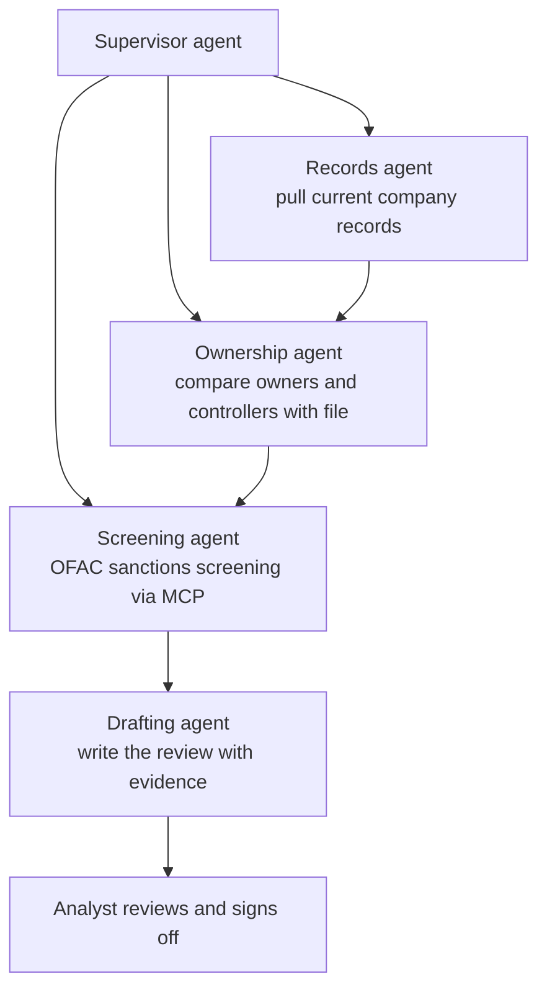

# Corporate KYC Refresh Agent

**Runs periodic KYC reviews for corporate customers: pulls current company records, lists ownership and control
changes, screens names against the OFAC sanctions list, and drafts the review for analyst sign-off.**

> **Status: design stage.** This repository describes the planned design. Progress will be added here.
>
> **Source code is private.** I'm happy to walk through the design on request.

## The problem

Under FinCEN's Customer Due Diligence (CDD) rule, banks must identify and verify the beneficial owners of legal
entity customers and keep that information up to date. Periodic refresh reviews mean re-pulling company records,
comparing them with what is on file, screening every new name and writing up the review.

## How it works

A LangGraph supervisor coordinates four specialist agents. Each one has its own tools and output schema, and the
supervisor checks every hand-off.

## What the review covers

- **Beneficial owners:** each individual owning 25% or more, directly or indirectly
- **Control person:** one individual with significant control, such as the CEO or CFO
- **Changes since the last review:** new, removed or changed owners, controllers, address, legal name or business
  activity
- **Sanctions screening:** every entity and individual name screened against the OFAC SDN list, with match scores
  and the reason each possible match was cleared or escalated

## MCP tools

| Tool | Purpose |
|---|---|
| `get_company_record` | Current registry details for the entity |
| `get_kyc_file` | What the bank holds from the last review |
| `screen_ofac` | Screens a name against the OFAC SDN list and returns candidate matches |

## Key design choices

- **The agent never clears a true sanctions match.** Possible matches are shown with evidence; only an analyst can
  clear or escalate.
- **Every change is evidenced.** Each listed change cites the record it came from.
- **Ownership arithmetic in code.** Indirect ownership through layers of entities is calculated in code, not by the
  LLM.
- **Draft only.** The agent writes the review; an analyst signs it off.

## Stack

Python · LangGraph (multi-agent) · MCP · Claude API · Supabase

## Screenshots

To be added to [assets/screenshots](assets/screenshots).
